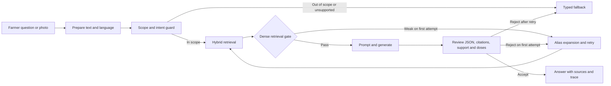

# Grounded Crop Disease Diagnosis and Treatment Advisory

A retrieval-augmented advisory application for crop disease and pest questions. A farmer describes symptoms in text or uploads a plant photo for a symptom-only description. The system retrieves passages from its knowledge base, proposes a diagnosis and cited advice, and checks scope, retrieval strength, citations, evidence support, and pesticide quantities before returning an answer. When evidence is insufficient or a question is out of scope, it returns a typed fallback rather than presenting unsupported advice.

## Project links

- [Submitted project report (PDF)](LLM_ESE_Project_Report%28Shivam%20Kadam%20-%202023300099%29.pdf)
- [Full local-model evaluation report](results/kaggle_batch/REPORT.md)
- [Evaluation status and limitations](results/RESULTS_STATUS.md)
- [Live Streamlit application](https://crop-disease-rag-advisor.streamlit.app)
- [GitHub repository](https://github.com/ShivamKadam63s/crop-disease-rag-advisor)
- [Windows runbook](RUN_WINDOWS.md) and [Mac/Linux runbook](RUN_MAC_UNIX.md)

## Capabilities

- Text-based crop disease and pest questions, with language selection for English, Hinglish, Hindi, or Marathi. Hosted backends can translate supported Hindi/Hinglish input to English for retrieval and localize accepted answers.
- Optional photo input. A vision model describes visible symptoms only; the farmer can edit the description before it enters the regular diagnosis pipeline.
- Hybrid retrieval using dense BGE embeddings and BM25, crop filtering, glossary aliases, Reciprocal Rank Fusion, and related management-passage expansion.
- LangGraph scope checks, retrieval gate, answer review, one retry, typed fallbacks, and an answer-specific workflow viewer.
- Quick, Detailed, Simple, Prevention, and Organic answer styles. The UI renders detailed-guide labels as separate sections even if the model returns them inline.
- Citations with source viewing, uncertainty notices, request monitoring, and CSV export.

## Architecture



The Streamlit RAG experience and RAG-enabled `POST /diagnose` requests use the LangGraph pipeline. Retrieval and generation can run in-process (the default) or as separate FastAPI services. The API's `use_rag=false` option is a raw generation path and does not apply the full graph review.

## Quick start

Python 3.10-3.12 is recommended. These commands install the lightweight app dependencies; first use may download the embedding model.

**Windows PowerShell**

```powershell
py -3.11 -m venv .venv
.\.venv\Scripts\Activate.ps1
$env:PYTHONUTF8 = "1"
python -m pip install --upgrade pip
python -m pip install -r app/requirements.txt
Copy-Item .env.example .env
```

**macOS / Linux**

```bash
python3 -m venv .venv
source .venv/bin/activate
python -m pip install --upgrade pip
python -m pip install -r app/requirements.txt
cp .env.example .env
```

Set valid provider credentials in `.env`; never commit that file:

```dotenv
LLM_API_KEY="your_provider_key"
LLM_BASE_URL="https://api.groq.com/openai/v1"
LLM_MODEL="openai/gpt-oss-20b"
```

Start the app from the repository root:

```text
streamlit run app/streamlit_app.py
```

The built knowledge base is checked in under `artifacts/kb/`. For full CPU/GPU setup, model training, evaluation, services, and deployment, follow the platform-specific runbooks. `requirements-full.txt` lists research dependencies; quantized training and inference require a compatible NVIDIA CUDA environment.

## Models and generation settings

| Use | Current configuration |
|---|---|
| Hosted text model | Defaults to `openai/gpt-oss-20b` via the OpenAI-compatible Groq API. Set `LLM_API_KEY`, `LLM_BASE_URL`, and `LLM_MODEL`. |
| Photo model | `LLM_VISION_MODEL` overrides the selection; otherwise `agri/vision.py` tries `qwen/qwen3.8-27b`, then `meta-llama/llama-4-scout-17b-16e-instruct`. |
| Local study variants | Qwen2.5-0.5B-Instruct: FP16, INT8, NF4, LoRA, QLoRA, and merged LoRA-NF4; see `configs/variants.yaml`. |
| Other backends | Ollama (`qwen2.5:0.5b`) and mock (offline plumbing tests). |

OpenAI-compatible generation sends a minimum `max_tokens` budget of 2,048; mode-specific settings are in `agri/prompts/builder.py`. This is a maximum, not a target response length. The hosted text model was not included in the controlled local-model evaluation grid.

## Retrieval and safety

The knowledge base currently covers six crops (rice, wheat, tomato, cotton, groundnut, and sugarcane), 18 disease/pest labels, and general pesticide-safety guidance. Retrieval uses `BAAI/bge-small-en-v1.5`, FAISS, BM25, Reciprocal Rank Fusion, crop filtering, glossary alias expansion, and parent-chunk expansion. Long queries can be split into overlapping windows.

The calibrated dense-retrieval gate is **0.70** in `artifacts/calibration.json`. Weak first-pass retrieval can trigger one retry with fewer chunks and an alias-expanded query when the retriever supports query expansion. Answers are reviewed for valid structure, known labels, crop consistency, citations that support the diagnosed disease, lexical support, and unsupported pesticide quantities. A failed review can trigger one strict retry; a second failure falls back.

**Knowledge-base limitation:** the checked-in crop cards are seed content drafted from general agronomic knowledge. They have not been verified against ICAR, state-university, or KVK bulletins. They contain no numeric pesticide doses; the app directs users to the product label and a local agriculture officer. Treat advice as advisory, inspect its citations, and seek qualified local guidance before acting.

## Evaluation results

The local-model study in `results/kaggle_batch/REPORT.md` includes test, handwritten, terminology, long-query, and out-of-distribution suites. Selected results:

| Configuration | Result |
|---|---|
| QLoRA + retrieval, raw output | 0.920 test accuracy (150 questions), 0.833 handwritten accuracy (36), 0.725 terminology accuracy (40) |
| QLoRA + retrieval + decision graph | 0.760 test accuracy, 0.778 handwritten accuracy, 0.975 OOD refusal rate (40 OOD questions) |
| Hosted `gpt-oss-20b` | Not included in the controlled evaluation grid |

Raw generator results and graph-pipeline results are not directly interchangeable: the graph may withhold answers after retrieval or review checks. See the [generated evaluation report](results/kaggle_batch/REPORT.md) and [submitted PDF](LLM_ESE_Project_Report%28Shivam%20Kadam%20-%202023300099%29.pdf) for metrics, efficiency, and limitations.

### Human evaluation

`agri/evaluation/human.py` creates rating sheets for correctness, safety, and clarity and aggregates completed ratings. The sheets in `results/kaggle_batch/human_eval/` are **unrated**; this repository does not yet contain completed human scores. Ratings require human reviewers and should not be inferred from model-generated scores.

To create a sheet, first ensure predictions exist at `results/runs/<run>/<suite>_preds.jsonl`, then run:

```bash
python -m agri.evaluation.human sample --run qlora_nf4__rag-on__raw --suite handwritten --n 30
```

Raters save filled copies as `*_rated_<name>.csv` under `results/human_eval/`. Aggregate them with:

```bash
python -m agri.evaluation.human aggregate
```

## Repository map

| Path | Contents |
|---|---|
| `app/streamlit_app.py` | Streamlit advisor, citations, source viewer, workflow viewer, and monitoring |
| `agri/orchestrator/` | LangGraph pipeline, intent guard, review, language handling, and fallbacks |
| `agri/retrieval/` | Dense/BM25 retrieval, FAISS store, embedder, and optional retrieval API |
| `agri/generation/` | Hugging Face, OpenAI-compatible, Ollama, and mock generation backends |
| `agri/prompts/builder.py` | Shared prompts and answer-style configuration |
| `agri/kb/` | Document ingestion, chunking, knowledge-base build, and validation |
| `agri/datagen/` | Dataset construction and leakage/schema verification |
| `agri/train/` | SFT data, LoRA/QLoRA training, and adapter merge |
| `agri/evaluation/` | Quality, retrieval, calibration, efficiency, load, and human-evaluation tools |
| `data/raw_docs/` | Seed knowledge-base source documents |
| `artifacts/kb/` | Built cards, chunks, embeddings, index, and manifest |
| `configs/` | Retrieval, decision, prompt, and model-variant settings |
| `LLM_ESE_Project_Report(Shivam Kadam - 2023300099).pdf` | Submitted academic project report |
| `results/kaggle_batch/` | Kaggle evaluation outputs, generated report, plots, and unrated human sheets |

## Useful commands

Run from the repository root with the required dependencies installed:

```bash
python -m agri.kb.build
python -m agri.datagen.build_dataset
python -m agri.datagen.verify
python -m agri.evaluation.calibrate
python -m agri.evaluation.retrieval_eval
```

For live API regression checks, see `DEPLOY_AND_TEST.md`. Scripts under `scripts/` include training and full evaluation; these may require CUDA, model downloads, API credentials, and hours of compute. Review the runbooks before running them.

## Deployment

For Streamlit Community Cloud, use `app/streamlit_app.py` as the entry point and `app/requirements.txt` for the slim dependencies. Add `LLM_API_KEY`, `LLM_BASE_URL`, and `LLM_MODEL` in Streamlit Secrets; `LLM_VISION_MODEL` is optional. Include the required `agri/`, `app/`, `configs/`, `data/`, and `artifacts/kb/` files in the deployed repository. Never commit `.env` or provider credentials.

The FastAPI application is in `agri/service.py`. Independent retrieval and generation services can be started using the platform runbooks and enabled with the `retrieval.mode` and `generation.mode` settings in `configs/config.yaml`.

## Limitations and future work

- Crop coverage is limited to the six crops and 18 labels in the seed knowledge base; source cards need review against authoritative, region-specific bulletins.
- Romanized Hindi/Hinglish detection and hosted translation can miss local spellings or meaning; native-speaker validation is still needed. Marathi output can be selected explicitly.
- Long inputs reduce retrieval and answer quality. The calibrated 0.70 gate favors safety and can reject valid in-scope questions.
- The hosted generator is not benchmarked in the local-model experiment; local-model results do not establish hosted-model quality.
- Expert and farmer ratings have not been completed.
- Future work includes reviewed ICAR/state-university/KVK material, broader regional coverage, controlled hosted-versus-local benchmarking, multilingual embeddings and re-ranking, and independent farmer-question evaluation with experts and farmers.