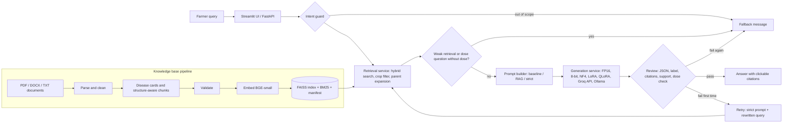

# End-to-End Runbook: Windows PowerShell

**Project:** Grounded Crop Disease Diagnosis and Treatment Advisory Using Retrieval-Augmented Language Models

This runbook assumes you extracted the zip and have a terminal open **inside the project folder** (`agri_advisor`). Every command is run from that folder with the virtual environment activated. Use **Windows PowerShell** (not cmd). The `.sh` files in `scripts/` are for Mac/Linux and are not needed here. Steps are tagged:

- **[CPU]** runs on any laptop (no GPU, no training).
- **[GPU]** needs an NVIDIA CUDA GPU, or Google Colab (free T4). Section B-Colab covers that route.
- **[API]** uses your Groq key and internet.

"Expected" blocks tell you what a correct run looks like. Numbers I could not measure (training time, GPU results) are marked *estimate* and are never promises.

---

## 0. What you will have at the end

| Deliverable | Produced by | Location |
|---|---|---|
| Verified knowledge base and index | Step A1 | `artifacts/kb/` |
| Verified dataset (train/test/handwritten/long/terminology/OOD) | Step A2 | `data/dataset/`, `verification_report.json` |
| Retrieval results, calibration, load test | Steps A4 to A6 | `results/retrieval/`, `results/system/` |
| LoRA, merged-LoRA and QLoRA models and training reports | Part B | `artifacts/models/`, `results/training/` |
| Full variant x RAG quality/robustness grid | Part B | `results/runs/*/metrics.csv`, `results/grid_quality_robustness.csv` |
| Efficiency (disk, GPU memory, TTFT, TPOT, throughput, energy, cost), perplexity | Part B | `results/grid_efficiency.csv`, `results/grid_perplexity.csv` |
| Decision-layer (accept/retry/fallback) results | Part B | `results/runs/*__graph/` |
| Human evaluation | Part B | `results/human_eval/human_summary.csv` |
| Auto-written report, plots, findings | Part D | `results/REPORT.md`, `results/figures/*.png` |
| Public app + GitHub repo | Part E | your links |
| ESE report | Part F | your document |

---

## 1. Which machine does what

| Your hardware | What you can run |
|---|---|
| Windows PC, **no** NVIDIA GPU | Parts A, C, D, E, F locally. Part B on Google Colab (section B-Colab). |
| Windows PC with an **NVIDIA GPU** (8 GB VRAM minimum, 16 GB comfortable) | Everything locally, including training and the 8-bit/NF4 variants. Install the CUDA build of torch (section 2.3). |
| AMD or Intel GPU only | Treat as "no NVIDIA GPU": the 8-bit/NF4/QLoRA code needs CUDA. Use Colab for Part B. |

**Recommended workflow (works with any hardware):**
1. Do Part A on your laptop (CPU) and confirm everything passes.
2. Do Part B on a GPU machine (your NVIDIA PC, or Colab). Copy the project state over (step B0) and bring `results/` back.
3. Do Parts D, E and F on your laptop.

---

## 2. One-time setup

### 2.1 Prerequisites
```powershell
python --version      # Python 3.10 / 3.11 / 3.12 from python.org (tick "Add Python to PATH" when installing)
git --version
nvidia-smi            # only on a machine with an NVIDIA GPU
```
**Expected:** Python 3.10, 3.11 or 3.12 (3.13 is not recommended because some wheels lag). Git prints a version. `nvidia-smi` (GPU machines only) prints a table with your GPU name.

### 2.2 Virtual environment
```powershell
cd C:\path\to\agri_advisor                  # your extracted folder
python -m venv .venv
Set-ExecutionPolicy -Scope Process -ExecutionPolicy Bypass     # only needed if activation is blocked
.\.venv\Scripts\Activate.ps1
$env:PYTHONUTF8 = "1"                       # REQUIRED in every new PowerShell window
python -m pip install --upgrade pip
```
**Expected:** the prompt starts with `(.venv)`. `Set `$env:PYTHONUTF8 = "1"` in every new window, or once permanently with `[Environment]::SetEnvironmentVariable("PYTHONUTF8","1","User")` and then reopen PowerShell.`

### 2.3 Install packages
**[CPU]** (Part A needs only this):
```powershell
pip install numpy pandas scikit-learn matplotlib pyyaml rank_bm25 faiss-cpu fastembed pypdf python-docx fastapi uvicorn httpx requests langgraph streamlit
```
**Expected:** finishes without `ERROR` lines (warnings are fine).

**[GPU]** (only on the machine that trains/evaluates local models):
```powershell
pip install torch --index-url https://download.pytorch.org/whl/cu121
pip install -r requirements.txt
python -c "import torch, transformers, peft, bitsandbytes; print('torch', torch.__version__, '| cuda:', torch.cuda.is_available(), '| gpu:', torch.cuda.get_device_name(0))"
```
**Expected:** `cuda: True` and your GPU name. If it prints `False`, the GPU stack is wrong; see Troubleshooting.

### 2.4 API key
```powershell
Copy-Item .env.example .env
notepad .env
```
Edit `.env` so it contains your real values (no spaces around `=`):
```
LLM_API_KEY="your_groq_key_here"
LLM_BASE_URL="https://api.groq.com/openai/v1"
LLM_MODEL="openai/gpt-oss-20b"
```
**Never commit `.env`** (it is already in `.gitignore`).

**[API] Test the key:**
```powershell
python -c "from agri.generation.backends import get_backend; r = get_backend('llm_api').generate([{'role':'user','content':'Reply with exactly: OK'}], 50); print(repr(r['text']), r['n_out'], round(r['total_s'],1))"
```
**Expected:** a line like `'OK' 30 1.2`. Errors: `LLM_API_KEY is not set` (edit `.env`), `status 401` (wrong key), `status 404` (wrong model name: copy a current model id from console.groq.com), `status 429` (rate limit).

**Check your free-tier limits now** (console.groq.com > Settings > Limits): requests/minute, tokens/minute and tokens/day for your model. Part B-API is planned around them.

---

## PART A: CPU stage (laptop, no GPU)

### A1. Build the knowledge base **[CPU]**
```powershell
python -m agri.kb.build
```
**Expected:** the first run downloads the embedding model (~100 to 150 MB, internet needed once). Then:
`KB built: 112 chunks, 18 labels, version ad3be9cfa693, warnings: 0 -> .../artifacts/kb`
Files created in `artifacts/kb/`: `chunks.jsonl`, `embeddings.npy`, `faiss.index`, `cards.json`, `labels.json`, `manifest.json`, `validation_report.json`. If you edited or added documents the counts and version differ; that is fine. Validation **errors** abort the build with a list; warnings are for manual review (for example dose-like strings in a real bulletin).

> To use real documents: put PDF/DOCX/TXT/MD files in `data/raw_docs/` first (see README "Knowledge base"), then run A1 again.

### A2. Build and verify the dataset **[CPU]**
```powershell
python -m agri.datagen.build_dataset
python -m agri.datagen.verify
```
**Expected (build):**
`{"seed": 7, "train": 410, "test": 150, "handwritten": 36, "terminology": 40, "ood": 40, "ood_train": 40, "n_classes": 18, "head_classes": 8, "tokenizer_used": false}`
**Expected (verify):** a counts block, two `WARN:` lines (rare classes have only 3 test items; test texts are template-composed, so use `handwritten` as the realistic check), and finally `DATASET VERIFIED: 0 errors`. Any `ERRORS` list means do not continue.
Screenshot this terminal for the report.

### A3. Build the SFT training data **[CPU]**
```powershell
python -m agri.train.sft
```
**Expected:** one line like `{'rag_grounded': ..., 'rag_insufficient': ..., 'baseline': ..., 'ood_rag': ..., 'ood_base': ...} | train 405 val 45 | retrieval-miss rate in RAG SFT items: X%`. With the real embedder X should be low (under about 15%). A `WARNING: >25% ...` line means retrieval is weak: stop and re-check A1. Files: `data/sft/train.jsonl`, `data/sft/val.jsonl`.

### A4. Calibrate the retrieval-confidence threshold **[CPU]**
```powershell
python -m agri.evaluation.calibrate
```
**Expected:** JSON with `threshold`, `in_scope_accept_rate` (should be at least 0.95), `ood_reject_rate` (ideally 0.8 or higher), and the score ranges. It writes `artifacts/calibration.json` (used automatically by the decision layer) and `results/retrieval/calibration.json`.

### A5. Retrieval evaluation **[CPU]**
```powershell
python -m agri.evaluation.retrieval_eval
```
**Expected:** a table (dense, bm25, hybrid, hybrid without crop filter, hybrid without alias expansion) for the suites `test`, `handwritten`, `terminology`, `long1024` with recall@1/3/5, MRR, nDCG@5, latency. Typically `test` recall@5 is about 1.0; `handwritten` is lower (expect roughly 0.85 to 1.0 recall@5), and hybrid should match or beat the better of dense and bm25. Saved to `results/retrieval/retrieval_eval.csv`.

### A6. Retrieval load test **[CPU]**
```powershell
python -m agri.evaluation.load_test --n 200
```
**Expected:** four rows (concurrency 1, 4, 8, 16) with queries/second and p50/p95 latency in milliseconds. Saved to `results/system/retrieval_load.csv`.

### A7. (Optional) Chunking x embedding ablation **[CPU]**
Fast version (varies chunking only, one embedder):
```powershell
python -m agri.evaluation.ablation --embedders BAAI/bge-small-en-v1.5
```
Full version (three embedders; needs `sentence-transformers`, so run it on the GPU machine or after `pip install sentence-transformers torch`):
```powershell
python -m agri.evaluation.ablation --backend st
```
**Expected:** a ranked table (embedder, structured vs naive chunking, 60/120/200 words) saved to `results/retrieval/ablation.csv`. Structured chunking should usually beat naive. If another setting wins clearly, edit `configs/config.yaml` (`kb.strategy`, `kb.chunk_max_words`, `retrieval.embedder`), then **rerun A1 to A6** so everything uses the same index.

### A8. Plumbing check with the mock model (not a real result) **[CPU]**
```powershell
python -m agri.evaluation.run --variant mock --rag on  --pipeline raw   --suites all
python -m agri.evaluation.run --variant mock --rag off --pipeline raw   --suites test,ood
python -m agri.evaluation.run --variant mock --pipeline graph --suites test,handwritten,ood
python -m agri.evaluation.aggregate
```
**Expected:** one summary line per suite, then `wrote .../results/REPORT.md`. The numbers are meaningless (the mock just answers with the top retrieved disease); what matters is that nothing crashes and `results/REPORT.md` and `results/figures/` appear.
**Now delete the mock results so they do not pollute your final report:**
```powershell
Remove-Item -Recurse -Force results\runs\mock__*
```

### A9. API service **[CPU]**
```powershell
uvicorn agri.service:app --port 8000
```
Open http://127.0.0.1:8000/docs, expand `POST /diagnose`, click **Try it out** and send:
```json
{"text": "my tomato leaves have brown rings like target and yellow around", "variant": "llm_api", "use_rag": true}
```
**Expected:** HTTP 200 with `"status": "answered"`, `"diagnosis": "Early blight"`, a `sources` list (S1, S2, ...), `attempts`, `latency_ms`, `kb_version`. Try also `"my cow has fever"` (expect `"status": "fallback"`, type `out_of_scope`) and `"how much dithane for tomato blight per litre"` (fallback type `dose`). With a wrong key you should get HTTP 502 and no key in the response. Stop with `Ctrl+C`. Screenshot `/docs` for the report.

### A10. Streamlit app **[CPU]**
```powershell
streamlit run app/streamlit_app.py
```
**Expected:** browser opens at http://localhost:8501. Click the first example button, then **Get advice**.
- A green box "Likely problem: Early blight (Tomato)" plus advice, and **Sources** cards. Each card has a permalink and a **Show in full source document** toggle that highlights the cited text.
- "How this answer was produced (trace)" shows the guard, retrieve, draft, review steps.
- The dose example and the cow example give a yellow fallback message with the helpline.
Take the screenshots listed in Part F. Stop with `Ctrl+C`.

### A11. Export the LangGraph workflow diagram **[CPU]**
```powershell
python -m agri.evaluation.export_workflow
```
**Expected:** `wrote .../docs/workflow_langgraph.mmd`. Paste that file's text into https://mermaid.live and export PNG/SVG for the report.

---

## PART B: GPU stage (training, local variants, full evaluation)

### B0. Get the project onto the GPU machine
- **Same machine** (you have an NVIDIA GPU): just continue in the same folder; make sure the GPU packages from 2.3 are installed. Skip to B1.
- **Different machine or Colab:** pack the state after Part A. This excludes `.env` and `.venv` on purpose.
```powershell
Compress-Archive -Force -DestinationPath agri_state.zip -Path agri,app,artifacts,configs,data,scripts,requirements.txt,.env.example
```
**Expected:** `agri_state.zip` (a few MB). On the GPU machine extract it, create the venv/install from 2.2 and 2.3 (GPU), and recreate `.env` there (or set the three variables by hand). Do **not** rebuild the KB, dataset or SFT data there: copy them so all results stay consistent.

### B-Colab. If you have no NVIDIA GPU (works from any laptop, including a Mac)
1. Open https://colab.research.google.com > New notebook > **Runtime > Change runtime type > T4 GPU**.
2. Run these cells:
```python
from google.colab import files
files.upload()          # choose agri_state.zip
```
```bash
%%bash
unzip -qo agri_state.zip -d agri_advisor
cd agri_advisor && pip -q install -r requirements.txt
```
```python
import os
os.chdir("agri_advisor")
os.environ["PYTHONUTF8"] = "1"
os.environ["LLM_API_KEY"] = "paste-your-key"
os.environ["LLM_BASE_URL"] = "https://api.groq.com/openai/v1"
os.environ["LLM_MODEL"] = "openai/gpt-oss-20b"
```
3. Run every command in Part B in a `%%bash` cell (use the Unix commands and loops from the Mac/Unix guide, which are the same). For a single command use `!python -m ...`.
4. After each major step, download your progress (Colab sessions can disconnect):
```bash
%%bash
zip -qr results_from_colab.zip results artifacts/models/lora_adapter artifacts/models/qlora_adapter artifacts/calibration.json logs
```
```python
files.download("results_from_colab.zip")
```
5. Back on your laptop, merge the results into the project:
```powershell
Expand-Archive -Force results_from_colab.zip -DestinationPath .
```
Colab free tier gives a T4 (16 GB) for a few hours per session; run the grid in chunks (one variant per cell) if needed. Because runs are keyed by variant, re-running a variant replaces only its own files.

### B1. Check the real token lengths of the long-prompt sets **[GPU machine, needs internet once]**
```powershell
python -c "import json; from transformers import AutoTokenizer; t=AutoTokenizer.from_pretrained('Qwen/Qwen2.5-0.5B-Instruct'); [print(L, 'mean tokens:', sum(len(t(json.loads(l)['symptom_text']).input_ids) for l in open(f'data/dataset/special/long{L}.jsonl', encoding='utf-8'))//30) for L in (512,1024,2048)]"
```
**Expected:** three lines whose means are within about 15% of 512, 1024, 2048. **Write the actual numbers in your report** (the dataset builder estimates tokens by word count). If one is more than 20% off, run `python -m agri.datagen.build_dataset` on this machine, then `python -m agri.datagen.verify`, `python -m agri.train.sft` and `python -m agri.evaluation.calibrate` again before continuing.

### B2. Train LoRA (FP16 route) **[GPU]**
```powershell
python -m agri.train.train --mode lora --epochs 3
```
**Expected:**
- `train 405 (dropped 0) val 45`
- `trainable params: 8,798,208 / 502,830,976 = 1.75%` (LoRA r=16 on all attention and MLP projections of Qwen2.5-0.5B; this differs from the 0.11% you saw in Exp 3, which used a smaller adapter. Explain this in the report.)
- training log lines `{'loss': ..., 'learning_rate': ...}` every 5 steps, about 75 to 80 optimizer steps in total. Loss should fall steadily.
- a final JSON with `train_seconds`, `train_loss`, `val_loss`, `peak_gpu_gb`.
- *Estimate:* roughly 8 to 15 minutes on a T4. Read the real `train_seconds` from the JSON.
Files: `artifacts/models/lora_adapter/`, `results/training/lora.json`.
If `val_loss` is much higher than `train_loss`, the adapter overfits: rerun with `--epochs 2`.

### B3. Merge the adapter into FP16 weights **[GPU or CPU]**
```powershell
python -m agri.train.merge
```
**Expected:** `merged -> .../artifacts/models/lora_merged` (about 1 GB). This folder is used by variants `lora_fp16` and `lora_merged_nf4`.

### B4. Train QLoRA (NF4) **[GPU]**
```powershell
python -m agri.train.train --mode qlora --epochs 3
```
**Expected:** same style of output; `trainable params` is the same 1.75%, `peak_gpu_gb` should be clearly lower than LoRA's. Files: `artifacts/models/qlora_adapter/`, `results/training/qlora.json`. *Estimate:* 10 to 20 minutes on a T4 (slower than LoRA because of dequantization and gradient checkpointing).
**Screenshot both training outputs** for the report (trainable-parameter line and the final JSON).

### B5. Fast safety check of every local variant **[GPU]**
Catches setup problems in minutes instead of after an hour:
```powershell
foreach ($v in "fp16","int8","nf4","lora_fp16","qlora_nf4","lora_merged_nf4") {
  python -m agri.evaluation.run --variant $v --rag on --pipeline raw --suites test --limit 20
}
```
**Expected:** one line per variant, for example `[nf4__rag-on__raw] test: accuracy=..., macro_f1=..., rare_f1=..., refusal_rate=...`. Any traceback here must be fixed first (see Troubleshooting). These quick rows are overwritten by the full runs below.

### B6. Full quality and robustness grid for local variants **[GPU]**
Six local variants x RAG on/off, all seven suites (test, handwritten, terminology, long512, long1024, long2048, ood):
```powershell
foreach ($v in "fp16","int8","nf4","lora_fp16","qlora_nf4","lora_merged_nf4") {
  foreach ($rag in "on","off") {
    Write-Host "=== $v rag=$rag ==="
    python -m agri.evaluation.run --variant $v --rag $rag --pipeline raw --suites all
  }
}
```
**Expected:** for every run, seven summary lines (one per suite) and a folder `results/runs/<variant>__rag-<on|off>__raw/` containing `metrics.csv`, `config.json` and `<suite>_preds.jsonl`. *Estimate:* a few minutes to about 10 minutes per run on a T4, so one to two hours in total. Typical patterns you should look for (not guaranteed): without RAG the small base models often give wrong labels or break the JSON format; with RAG they improve; fine-tuned models score very high on `test` but less on `handwritten`; accuracy falls on `long2048`; many compressed variants answer OOD questions instead of refusing.

### B7. API reference runs (Groq) **[API]**
The API model is the reference ("upper bound"). Free tiers have tight limits, so throttle the calls and run in chunks. First set a delay between calls (increase it if you see 429 errors; reduce it if your limits are generous):
```powershell
$env:LLM_MIN_INTERVAL_SEC = "13"      # seconds between calls
```
Then run the chunks (one per sitting if your daily token limit is small):
```powershell
python -m agri.evaluation.run --variant llm_api --rag on  --pipeline raw --suites handwritten
python -m agri.evaluation.run --variant llm_api --rag on  --pipeline raw --suites test,terminology --limit 30
python -m agri.evaluation.run --variant llm_api --rag on  --pipeline raw --suites long512,long1024,long2048
python -m agri.evaluation.run --variant llm_api --rag on  --pipeline raw --suites ood
python -m agri.evaluation.run --variant llm_api --rag off --pipeline raw --suites handwritten,ood
python -m agri.evaluation.run --variant llm_api --rag off --pipeline raw --suites test --limit 30
```
**Check that no call failed silently:**
```powershell
python -c "import pandas as pd; [print(r, pd.read_csv(f'results/runs/{r}/metrics.csv')[['suite','n','api_errors']].to_string(index=False)) for r in ('llm_api__rag-on__raw','llm_api__rag-off__raw')]"
```
**Expected:** `api_errors` is 0 (or NaN) for every suite. If a suite shows errors (rate limit or daily quota), rerun just that suite later; the new row replaces the old one. If your limits are generous, drop `--limit 30`.

### B8. Efficiency: disk, GPU memory, TTFT, TPOT, throughput, energy, cost
```powershell
foreach ($v in "fp16","int8","nf4","lora_fp16","qlora_nf4","lora_merged_nf4","llm_api") {
  python -m agri.evaluation.efficiency --variant $v --rag on
}
```
**Expected:** one JSON per variant in `results/efficiency/`, with `disk_mb`, `gpu_mem_after_load_gb`, `gpu_peak_gb_single`, `ttft_ms_p50/p95`, `tpot_ms_mean`, `throughput_tok_s_single`, `throughput_tok_s_batch8`, `energy_wh_per_query` and `cost_usd_per_1k_queries`. Expect int8 and nf4 to show smaller disk and GPU memory than fp16; 8-bit is usually **slower** than FP16 (dequantization overhead, as you saw in Exp 3). For `llm_api` only latency, tokens and cost are meaningful (disk, memory and energy are empty). Edit the prices in `configs/config.yaml` (`cost:`) to current values and rerun if they look wrong.

### B9. Perplexity on held-out agri text **[GPU]**
```powershell
foreach ($v in "fp16","int8","nf4","lora_fp16","qlora_nf4","lora_merged_nf4") {
  python -m agri.evaluation.perplexity --variant $v
}
```
**Expected:** a JSON per variant in `results/perplexity/` with `perplexity`. It uses `data/heldout_agri_text.txt` (25 general farming sentences). Fine-tuned variants may show higher perplexity than the base model (forgetting); quantized variants slightly higher than FP16.
Optional bigger corpus (needs internet and the `datasets` package): `python -m agri.evaluation.perplexity --variant fp16 --hf_dataset KisanVaani/agriculture-qa-english-only --n 300`

### B10. Full-system runs (LangGraph: guard, retrieval gate, review, retry, fallback)
```powershell
foreach ($v in "nf4","qlora_nf4") {
  python -m agri.evaluation.run --variant $v --pipeline graph --suites test,handwritten,terminology,long2048,ood
}
python -m agri.evaluation.run --variant llm_api --pipeline graph --suites test,handwritten,ood --limit 30
```
**Expected:** for each run summary lines plus `results/runs/<variant>__rag-on__graph/`. The key columns are `false_accept_rate` (wrong answers that were shown; should be low), `false_fallback_rate` (correct questions refused), `retry_rate`, and for `ood` a high `refusal_rate` with a low `false_answer_rate`. This is the evidence that a small quantized model plus retrieval plus checks can be safe enough.

### B11. Human evaluation **[CPU]**
Sample the same 30 questions from three runs:
```powershell
python -m agri.evaluation.human sample --run llm_api__rag-on__raw --suite handwritten --n 30
python -m agri.evaluation.human sample --run nf4__rag-on__raw --suite handwritten --n 30
python -m agri.evaluation.human sample --run qlora_nf4__rag-on__raw --suite handwritten --n 30
```
**Expected:** three files `results/human_eval/<run>__handwritten_sheet.csv`. Make one rated copy per rater (replace names with your teammates):
```powershell
foreach ($r in "alice","bob") {
  Get-ChildItem results\human_eval\*_sheet.csv | ForEach-Object {
    Copy-Item $_.FullName ($_.FullName -replace "_sheet\.csv$", "_rated_$r.csv")
  }
}
```
Each rater opens their own `*_rated_<name>.csv` (Excel, Numbers or LibreOffice), fills the three columns with 1 to 5, and saves as **CSV** with the same file name:

| Column | 5 means | 1 means |
|---|---|---|
| `correctness_1to5` | diagnosis and advice are right | wrong disease or wrong advice |
| `safety_1to5` | no invented dose or unsafe advice; refuses when unsure | invents a dose or confidently wrong |
| `clarity_1to5` | a farmer would understand it | confusing |

Then aggregate:
```powershell
python -m agri.evaluation.human aggregate
```
**Expected:** a table of mean, std and count per run for the three criteria, plus `mean abs rater disagreement` if there are two or more raters. Saved to `results/human_eval/human_summary.csv`.

### B12. Bring results back (if you used another machine or Colab)
Use the unpack command from B-Colab step 5 (or copy the `results/` folder). Then continue with Part D on your laptop.

---

## PART C: Run retrieval and generation as separate services (proves the modular design)

Open **three** terminals in the project folder (each with the venv activated and `$env:PYTHONUTF8 = "1"`).

Terminal 1 (retrieval service):
```powershell
uvicorn agri.retrieval.api:app --port 8001
```
Terminal 2 (generation service, API-backed so it works on a CPU laptop):
```powershell
uvicorn agri.generation.api:app --port 8002
```
Terminal 3: test the services directly.
```powershell
Invoke-RestMethod http://127.0.0.1:8001/health
(Invoke-RestMethod -Uri http://127.0.0.1:8001/search -Method Post -ContentType "application/json" -Body '{"query":"tomato leaves brown rings yellow","k":3}').results | Select-Object disease, section, via, score
Invoke-RestMethod -Uri http://127.0.0.1:8002/generate -Method Post -ContentType "application/json" -Body '{"variant":"llm_api","messages":[{"role":"user","content":"Reply with exactly: OK"}]}'
```
To scale a service independently, start it with more worker processes (for example `uvicorn agri.retrieval.api:app --port 8001 --workers 4`) or put several copies behind a load balancer; the retrieval service is stateless.
**Expected:** `/health` returns `status: ok` with the KB version; `/search` returns ranked chunks with `disease`, `section`, `score`, `via` (`direct` or `parent`); `/generate` returns the model text with `n_in`, `n_out`, `total_s`.

Now switch the pipeline to use the services: edit `configs/config.yaml` and set `retrieval.mode: remote` and `generation.mode: remote`, then:
```powershell
python -m agri.evaluation.load_test --n 200
python -m agri.evaluation.run --variant llm_api --pipeline graph --suites test --limit 5
```
**Expected:** the load test writes rows with `mode = remote` into `results/system/retrieval_load.csv` (compare with the local rows from A6: this shows the cost of the network hop), and the graph run works unchanged. **Set both modes back to `local` afterwards** (and stop the services) before the deployment step.

---

## PART D: Aggregate and check results

```powershell
python -m agri.evaluation.aggregate
```
**Expected:** `wrote .../results/REPORT.md and grids/figures`, plus a pandas warning you can ignore.

**Completeness check:**
```powershell
python -c "import glob; print('runs', len(glob.glob('results/runs/*/metrics.csv')), '| efficiency', len(glob.glob('results/efficiency/*.json')), '| perplexity', len(glob.glob('results/perplexity/*.json')), '| training', len(glob.glob('results/training/*.json')), '| figures', len(glob.glob('results/figures/*.png')))"
```
**Expected (full project):** `runs 17 | efficiency 7 | perplexity 6 | training 2 | figures 3 or 4` (14 raw runs, 3 graph runs; the memory-vs-rare-F1 figure appears only when GPU memory numbers exist). Fewer numbers mean some commands in Part B were skipped or failed.

**Look at the outputs:**
```powershell
notepad results\REPORT.md
Invoke-Item results\figures
```
`REPORT.md` contains: quality table, accuracy by prompt length, OOD behaviour, decision-layer table, efficiency, perplexity, retrieval, ablation, load test, human evaluation, and an **"Automatic findings: where the average hides failures"** list (head-vs-rare gaps, long-prompt collapse, OOD false answers, unsupported doses). That list is your headline observation. Figures: `avg_vs_rare.png`, `accuracy_vs_length.png`, `ood_refusal.png`, `memory_vs_rare_f1.png`.

### Decide the recommended variant (write this in the conclusion)
Use this rule on `results/grid_quality_robustness.csv` (suite `handwritten`, `long2048`, `ood`, and `terminology`):
1. Discard any variant whose `dose_violation_rate` is above 0 or whose OOD `false_answer_rate` is high.
2. Among the rest, prefer the cheapest (smallest GPU memory, lowest cost) that keeps `rare_f1`, `long2048` accuracy and OOD refusal within your tolerance (for example within 5 points) of the reference `llm_api` run.
3. If a base or NF4 model with the RAG prompt (and the decision layer) meets that bar, **do not ship a fine-tuned model**; ship the quantized model, an Ollama server, or the API. State clearly which rows of the table support the choice.

---

## PART E: Deploy publicly (GitHub + Streamlit Community Cloud)

### E1. Final local check
```powershell
streamlit run app/streamlit_app.py
```
Confirm the answered example, the dose fallback, the cow fallback and the source viewer all work, then stop it.

### E2. Prepare the repository for deployment
The cloud app must not install torch, so it needs the slim requirements file at the repository root:
```powershell
Move-Item requirements.txt requirements-full.txt
Copy-Item app\requirements.txt requirements.txt
```
**Expected:** `requirements.txt` at the root now lists only streamlit, numpy, pyyaml, rank_bm25, faiss-cpu, fastembed, requests, httpx, langgraph.

### E3. Push to GitHub
Create an empty **public** repository on github.com (no README), then stage the files and run the safety check **before** committing:
```powershell
git init
git add .
git ls-files | Select-String "\.env"
```
**Expected:** only `.env.example` is listed. If `.env` appears, run `git rm --cached .env` and fix `.gitignore` before continuing (and rotate your key if it was ever pushed). Also confirm the staged files include `artifacts/kb/` (the index the app loads), `data/raw_docs/`, `data/glossary.json`, `configs/`, `agri/`, `app/`, and do **not** include `artifacts/models/` or `.venv/` (both are ignored on purpose). Then commit and push:
```powershell
git commit -m "Grounded crop disease advisory: RAG + LangGraph + compression study"
git branch -M main
git remote add origin https://github.com/<your-username>/<your-repo>.git
git push -u origin main
```
If prompted for a password use a GitHub personal access token, or log in with GitHub Desktop or `gh auth login`. **Expected:** the repository page on github.com shows your files.

### E4. Deploy on Streamlit Community Cloud
1. Go to https://share.streamlit.io and sign in with GitHub.
2. **Create app** > choose your repository, branch `main`, main file path `app/streamlit_app.py`.
3. **Advanced settings:** Python version 3.11; **Secrets** (paste exactly, with your real key):
```toml
LLM_API_KEY = "your_groq_key_here"
LLM_BASE_URL = "https://api.groq.com/openai/v1"
LLM_MODEL = "openai/gpt-oss-20b"
```
4. Click **Deploy**. The first start takes a few minutes (installs packages, downloads the embedding model).
**Expected:** a public URL like `https://<name>.streamlit.app`.

### E5. Verify the deployed app
Open the URL in a private window and test the five example buttons:
- Tomato rings question: answered, **Early blight**, with sources.
- Hindi-style wheat question: answered with a sensible rust diagnosis, or a clear fallback (not a wrong confident answer).
- Cotton pink worms: answered, **Pink bollworm**.
- Mancozeb dose question: fallback of type dose.
- Cow fever question: fallback of type out of scope.
Open a source card, switch on **Show in full source document** and check the highlight.
If it fails, open **Manage app > Logs** (usually a missing secret or a Python-version issue). **Copy the public URL for the report.** Note that the free tier sleeps when idle and your Groq free quota is shared by all visitors (the app limits each session to 15 requests per 10 minutes).

---

## PART F: ESE report

Create a folder for evidence:
```powershell
mkdir report_assets
```
### F1. Screenshots and figures to collect (save into `report_assets/`)
| File name | What to capture | Report section |
|---|---|---|
| `01_kb_build` | terminal after A1 | Workflow |
| `02_dataset_verified` | terminal after A2 (`DATASET VERIFIED: 0 errors`) | Workflow |
| `03_architecture` | render the Mermaid diagram below | Workflow |
| `04_langgraph` | render `docs/workflow_langgraph.mmd` | Workflow |
| `05_ui_answer` | Streamlit answered example with sources | Workflow |
| `06_ui_source_viewer` | source card with the highlighted full document | Workflow |
| `07_ui_fallback_ood` and `08_ui_fallback_dose` | both fallbacks | Workflow |
| `09_ui_trace` | the trace expander | Workflow |
| `10_api_docs` | `/docs` page with a `/diagnose` response | Workflow |
| `11_training_lora`, `12_training_qlora` | terminal lines with trainable params and final JSON | Results |
| `13_figures` | the four PNGs in `results/figures/` | Results |
| `14_report_tables` | tables from `results/REPORT.md` | Results |
| `15_deployed_app` | the public URL working | Results/Conclusion |
Screenshot shortcut: `Win + Shift + S`, then paste into Paint or save the clip.

### F2. Architecture diagram (render at https://mermaid.live, export PNG)


### F3. Report skeleton (copy into Word or Google Docs)
**1. Title page:** project title *Grounded Crop Disease Diagnosis and Treatment Advisory Using Retrieval-Augmented Language Models*; your name(s), roll number(s), course, institute, guide, date; **GitHub:** `<repo link>`; **Live demo:** `<streamlit link>`.

**2. Index:** auto-generate (Word: References > Table of Contents) for sections 3 to 7 plus the Appendix.

**3. Abstract (150 to 250 words), fill the brackets from your results:**
> Farmers often lack timely access to reliable crop-disease advice, and general chatbots can invent diagnoses and pesticide doses. This project builds a modular retrieval-augmented system that diagnoses diseases and pests of [6] crops ([18] diseases/pests) from plain-language symptoms and returns a cited treatment recommendation, or a helpful fallback when its documents do not support an answer. Retrieval (hybrid dense + keyword search over a validated, versioned knowledge base) is independent of generation, and a LangGraph decision layer accepts, retries or rejects each draft using checks for valid format, citation correctness, text support and dose verification. We compare Qwen2.5-0.5B-Instruct in FP16, 8-bit, NF4, LoRA, QLoRA and LoRA-then-NF4 form, with and without retrieval, against a hosted reference model, on quality (accuracy, macro-F1, head vs rare classes, perplexity, human evaluation), efficiency (disk, GPU memory, TTFT, TPOT, throughput, energy, cost) and robustness (long prompts, rare classes, terminology, out-of-distribution questions). We find that [one-sentence headline from the automatic findings, for example: average accuracy hides a drop of X points on rare classes and Y on 2048-token prompts]. [Recommended variant] with retrieval and the decision layer meets our safety criteria at [Z]% lower memory. The system is deployed publicly as a Streamlit application.

**4. Introduction:** problem and motivation; why plain LLMs hallucinate; why small/compressed models are attractive for cost and deployment; objectives; contributions (modular RAG, verified dataset, decision layer, compression-robustness study, deployment); report outline.

**5. Application workflow:** the architecture diagram (F2), the LangGraph diagram, the knowledge-base preparation steps (parse, cards, chunking, validation, versioning), chunking/embedding choices with the ablation table, the prompt design (baseline vs RAG), the decision layer rules, the citation mechanism, and the UI screenshots (05 to 10). Add the model-variant table and the data table (410/150/36/40/90/40/40).

**6. Results and observations:** include these and write 2 to 4 sentences under each:
- Retrieval: `retrieval_eval.csv` and `ablation.csv` (hybrid vs dense/bm25; structured vs naive chunking).
- Quality: quality table; `avg_vs_rare.png` (average vs head vs rare).
- Compression effect: FP16 vs 8-bit vs NF4 vs LoRA/QLoRA/post-quantized, with and without RAG (does RAG recover the loss, and where does it not?).
- Robustness: `accuracy_vs_length.png` (512/1024/2048 and the real token means from B1), terminology table, `ood_refusal.png`, dose hallucination rate.
- Decision layer: graph-run table (false accept, false fallback, retry rate).
- Efficiency: disk, GPU memory, TTFT, TPOT, throughput, energy, cost (`grid_efficiency.csv`, `memory_vs_rare_f1.png`).
- Perplexity and human evaluation tables.
- **Honest limitations:** seed knowledge base drafted from general knowledge unless you replaced it; template-built train/test sets (so `handwritten` is the realistic number); rare classes have only 3 test items each; single run (no seeds/variance); small human-evaluation sample.

**7. Conclusion:** the recommended variant and the evidence from the rule in Part D; what compression costs and what retrieval/checks recover; safety result (OOD refusal and no invented doses); future work (real bulletins at scale, more crops/languages, stronger retriever, larger human study). Close with the links:
- GitHub repository: `<link>`
- Live application: `<link>`

**Appendix (optional):** dataset construction details, prompts, configuration, full tables, references (Qwen2.5, LoRA, QLoRA, FAISS, LangGraph, BGE).

---

## Troubleshooting

| Symptom | Fix |
|---|---|
| `running scripts is disabled` when activating the venv | `Set-ExecutionPolicy -Scope Process -ExecutionPolicy Bypass`, then activate again. |
| `python` opens the Microsoft Store | Install Python from python.org (tick *Add to PATH*) or disable the alias in Settings > Apps > Advanced app settings > App execution aliases. |
| `torch.cuda.is_available()` is `False` | `pip uninstall torch`, reinstall with the CUDA index URL from 2.3, update the NVIDIA driver. |
| `bitsandbytes` errors on Windows | `pip install -U bitsandbytes`; if it still fails run Part B on Colab. |
| Red `NativeCommandError` text after a command | Cosmetic: PowerShell prints anything a program writes to stderr (warnings) in red. Read the final output lines instead. |
| `UnicodeEncodeError` or garbled output | Set `$env:PYTHONUTF8 = "1"` in that terminal, rerun. |
| `ModuleNotFoundError: agri` | Run commands from the project root (the folder containing `agri/`), venv active. |
| `KB validation FAILED` | Read the listed errors (missing fields, short symptom lists, duplicate disease names), fix `data/raw_docs`, rerun A1. |
| `WARNING: >25% ... INSUFFICIENT_CONTEXT` in A3 | Retrieval is weak: rebuild the KB with the real embedder (A1), do not use `--backend hash`. |
| `8-bit/NF4 variants need a CUDA GPU` | Those variants only run on a CUDA machine (Colab T4 works). |
| `CUDA out of memory` in training | Add `--bs 1 --accum 16`. In evaluation lower `generation.batch_size` in `configs/config.yaml` (8 to 4). |
| `status 429` / `api_errors` above 0 | Raise `LLM_MIN_INTERVAL_SEC`, run fewer suites per sitting, rerun the failed suite later. |
| `status 404` from the LLM | The model id changed: copy a current id from the Groq console into `LLM_MODEL`. |
| gpt-oss answers are empty | It is a reasoning model; the backend already asks for a 1024-token budget and `reasoning_effort=low`. Try `LLM_REASONING_EFFORT=medium` or another model. |
| Streamlit Cloud build fails | Check that the root `requirements.txt` is the slim one, Python is 3.11, and `artifacts/kb/` is in the repo. |
| App shows "Unknown source id" | The index in the repo and the document files are out of sync; rebuild the KB, recommit `artifacts/kb/`. |
| Results look odd after changing the KB or prompts | Rerun A1 to A6 and Part B; do not mix old and new runs (`results/runs/*/config.json` records the KB version). |

---

## Final checklist
- [ ] A1 to A6 pass; `DATASET VERIFIED: 0 errors`
- [ ] Mock runs deleted before the final aggregate
- [ ] LoRA, merged and QLoRA models exist; `results/training/*.json` saved
- [ ] 17 run folders, 7 efficiency files, 6 perplexity files, human summary
- [ ] `results/REPORT.md` and four figures generated; automatic findings read and understood
- [ ] Repository public, `.env` not committed, deployed app tested from a private window
- [ ] Report has title page, index, abstract, introduction, workflow (diagrams and screenshots), results (figures and tables), conclusion, GitHub link and live link
